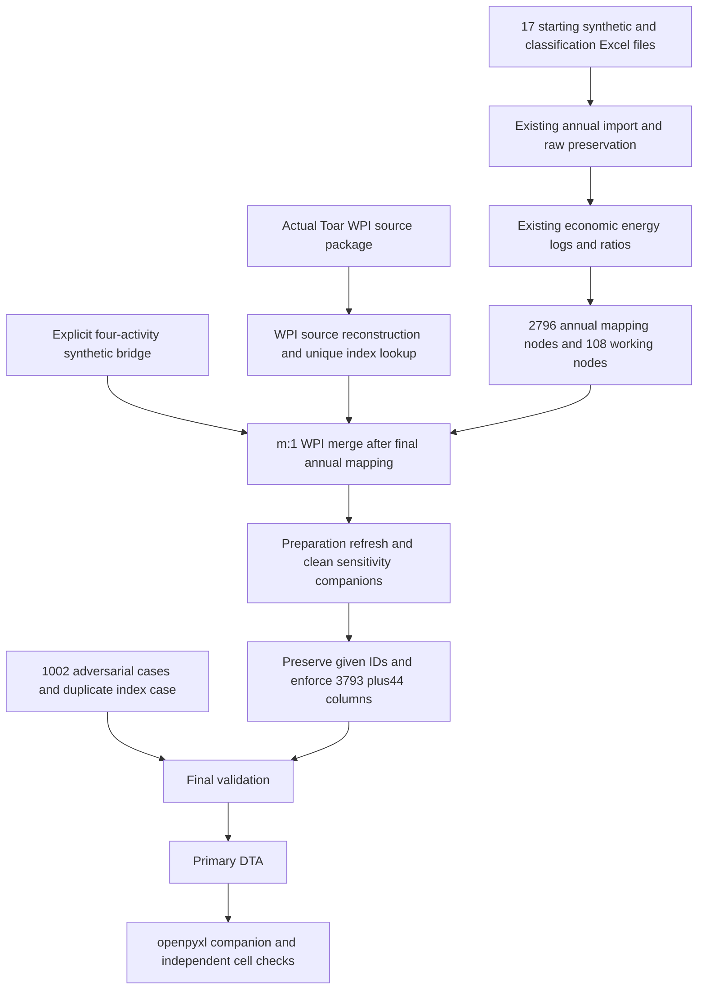
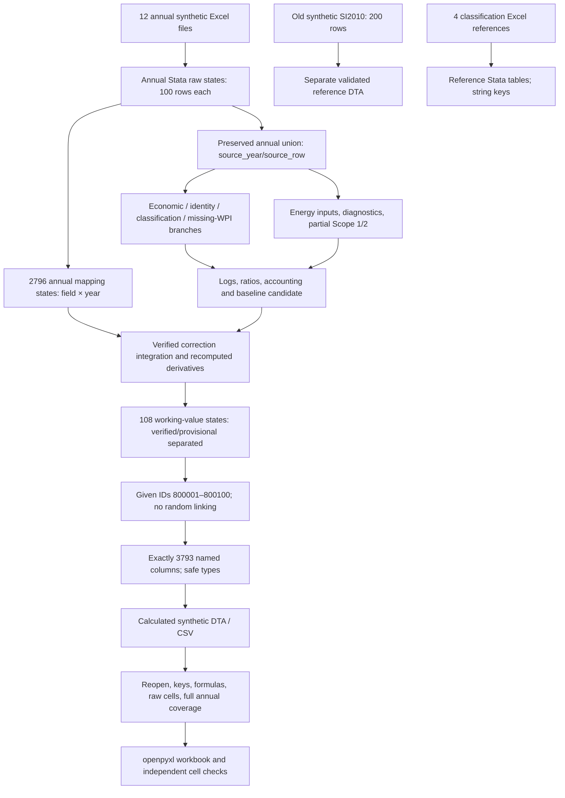

# Current WPI extension of the existing G0 DAG

Grains: WPI source/index `isic4 source_year`; fixture bridge `industry_code`; annual states and final data `source_year source_row`; synthetic panel `selected_firm_id source_year`; report coverage `variable source_year`. Source uniqueness is asserted before each m:1 join. No2016 company records; reference2016 rows stay missing. WPI staging happens in existing G0_06; firm deflation happens after annual correction/working integration, avoiding stale field values. Existing missing-only price fields are widened to double before materializing real values.

Each added edge has a node triage/decision and [process registry](results/process_registry.csv) entry. Executed source reconstruction and deflation are separate from source-verification limitations. Read [WPI decisions](WPI-INTEGRATION.md) and [row0 status](results/ROW0-STATUS.md).

## Preserved predecessor DAG description

# Executed synthetic G0 DAG and grain contracts

References Y/Z are staged and validated source states. Their absence of a downstream merge is intentional: old2010 is a different reference universe and the company data do not supply the product-level key required for HS concordance. Do not invent many-to-many links merely to make an arrow.

| State | Grain / input-output contract | Decision |
|---|---|---|
| Annual raw (12) | One synthetic source record, unique source_year/source_row; exactly 100 rows/year | Preserve every Excel cell as raw string, headers disambiguated by position; no trimming of IDs |
| Old SI2010 reference | 200 separate fictional records, unique synthetic source row | Validate/import only; not a 13th wave or replacement observation |
| Classification references (4) | Original reference row and supplied classification codes | Strings retained, no assumed unique many-to-many merge |
| Economic and energy baseline children | Same 1,200 provenance keys; no observation deletion | Reuse G0 methods; record missing/invalid/negative/zero separately |
| WPI state | Same 1,200 keys; unavailable prices/real values | No identity deflator or original-data fallback |
| Annual mapping (2,796) | One variable and its state/source text for 100 records in one year | Formula, source and annual code/unit/universe policy in executable child; own DTA/log/triage/decision |
| Working-value states (108) | Nine indicators × 12 years, same annual records | Verified values take precedence; explicit provisional status; no blanket missing-to-zero |
| Identity | 100 preassigned fictional firms × 12 actual years | Preserve 800001–800100; assert all 12 links for each; missing 2016 remains a gap |
| Final data | Exactly 1,200 rows × 3,793 names; both provenance and synthetic firm/year keys unique | No truncation; every changed storage type reported |
| Coverage | Variable × year; 3,793 × 12 = 45,516 cells | Exact observed/missing/zero/negative counts; denominator 100/year |
| Workbook | Faithful formatted export of calculated Stata results | openpyxl only, typed numbers/strings; every complete-data cell independently reopened and compared |

[Executed annual node registry](results/executed_node_registry.csv) links each materialized source/working node to input, edge and output. Node `triage.md`/`decision.md` files under `dag/nodes/` preserve execution and interpretation separately. Process-level nodes accompany imports, base stages, integration, identity, final validation and publication. The primary and complete batch log prove ordering; per-stage logs preserve assertions and failures.
