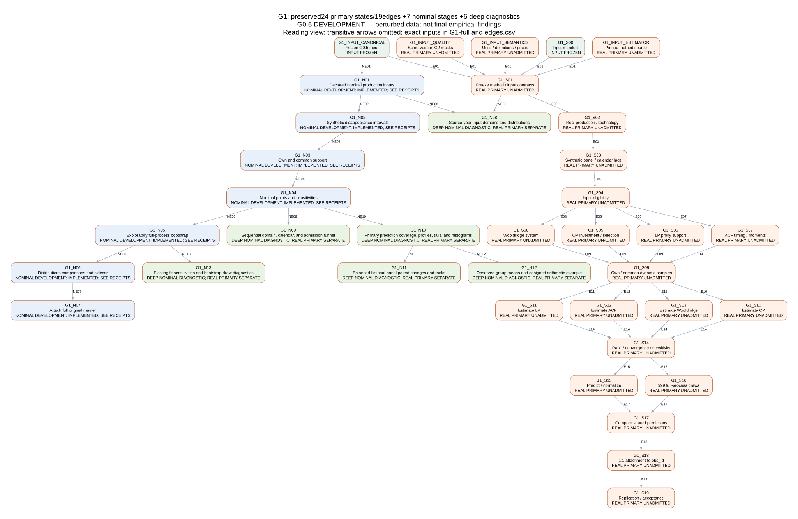

# DAG index: G0, G0.5 and G1

The preserved analytical graphs cover this repository's three stages. They are separate module graphs and contracts; a single integrated interactive G0→G0.5→G1 canvas has not been built here. This is not a completion claim for all 44 research work items.

| Module | Coverage | Open in GitHub |
|---|---|---|
| G0 | Complete frozen registry: 6,409 nodes and 3,369 edges; 17 execution stages | [Full DAG JSON](../releases/2026-09-13-data-foundation/stata-preparation/registry/dag.json), [stage order](../releases/2026-09-13-data-foundation/stata-preparation/registry/stages.json) |
| G0.5 | Source selection, scaling, clustering, fictional panel assignment and package validation, with per-node decisions and contracts | [Node records](../work-items/G0.5/dag/nodes/), [edge registry](../work-items/G0.5/dag/registries/edges.csv), [grain contracts](../work-items/G0.5/dag/registries/grain-contracts.json) |
| G1 | 37 nodes and 32 producing edges, including nominal N01–N07 and diagnostic N08–N13 stages; full direct dependencies retained | [Full diagram](../work-items/G1/dag/G1-full.svg), [readable diagram](../work-items/G1/dag/G1.svg), [contracts and explanation](../work-items/G1/dag/README.md) |

G0's complete JSON is a registry, not a ready-to-read visual chart; GitHub may offer Raw/Download for a large file. G0.5 currently has node/edge contracts rather than one rendered overview. G1 has both rendered diagrams and Mermaid/Graphviz sources. These graph files are on `main`, so downloading the large data release is not required to inspect them.

