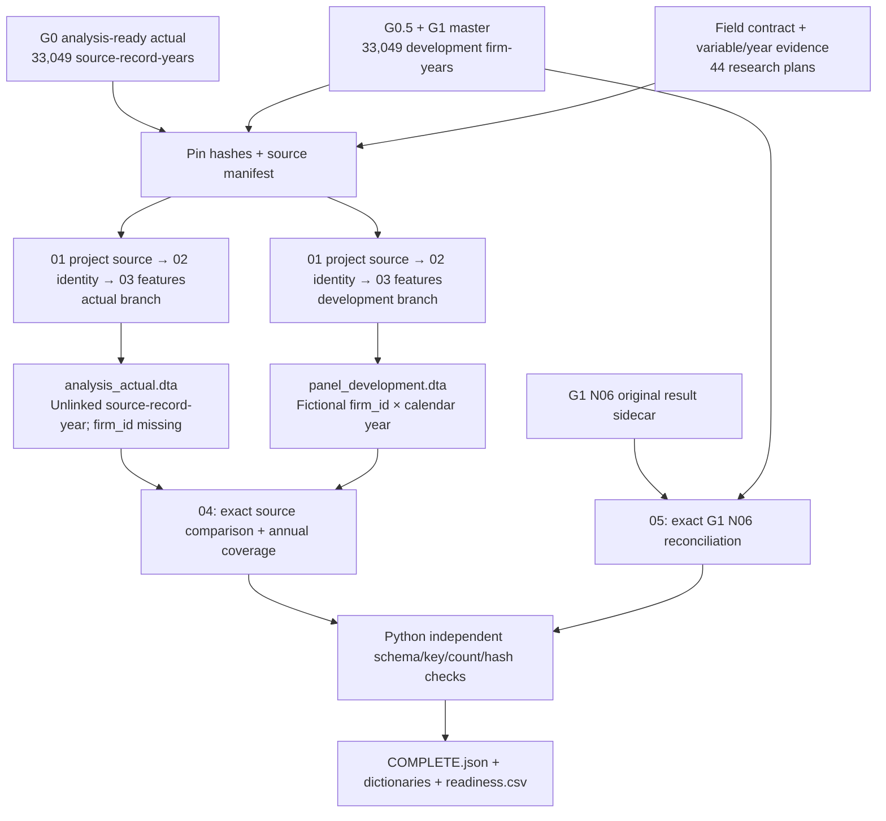
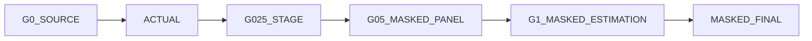

# DAG: sumber yang sudah ada → dataset siap digunakan secara struktural

Controller: `downstream/00_MASTER.do`. Ini cabang baru dari hasil G0/G1 yang sudah
tersedia. Master tidak mengestimasi ulang G1 atau menjalankan ulang overall raw.

Node = retained artifact, not a claim that each intermediate is a separate file.
Projection, identity and feature alignment are explicit native child do-files;
their intermediate state stays in the owned Stata session until export. Source
and final datasets, aggregate coverage states, native logs and receipts persist.
There is no join from actual records to development records.

The registry names each producing process, input/output state and grain.
`triage.md` and `decision.md` in each node record what is produced, verified and
still conditional. The complete inherited G0 DAG and G1 DAG remain in their
existing folders, linked through the source input contracts.

## Accepted masked-input branch — 17 September 2026

Owner-selected order: G0 → G0.25 → G0.5 → G1. The accepted G0 master is reused;
all following numerical/model stages ran locally. G0.5 adds only fictional panel
links, with no second numeric perturbation. G1 is freshly estimated from the
masked values. No post-estimation masking is applied.

The detailed numeric masking subgraph remains MASK_BASE → MASK_DERIVED → MASK_IDS,
with MASK_QA and MASK_RECOVERY. G1 invokes E01–E19 and N01–N07 internally; their
native intermediate datasets remain in the run.

Acceptance: downstream/g025_to_g1/latest.json and RESULT.md. The earlier
G1.5-after-G1 proposal is superseded by this explicit owner direction.
