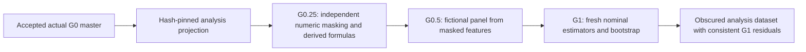

# Obscure before panel construction and G1 estimation

Owner direction, 17 September 2026: use the order **G0 → G0.25 → G0.5 → G1**
so the attached residuals are estimated from the numerical inputs visible in
the final obscured dataset. No post-G1 masking is applied.



## Local entry point

From the repository root:

```sh
python3 downstream/g025_to_g1/build.py "/path/to/output-volume"
```

The pipeline uses the accepted G0 parent and projection pinned in
`downstream/reports/latest-build.json`. It does not re-import the annual raw
Excel files in this local repair. The exact G0 source hash is recorded, and
`vs_industry_code` is attached unchanged from that source because G1 requires
it. The 516-column analytical view is an explicit projection of the full G0
master, not a claim that every raw source field is distributed.

Each execution makes a new directory outside git. Source snapshots, logs,
input manifests and intermediate DTAs are retained. G0.25 values and all
G1 transformations use native Stata; Python supplies keyed draws, validation,
orchestration and recovery packaging. The original masking seed and backup
remain private and continue to reproduce the changes for the pinned source.

## Stage contracts

| Stage | Grain and behavior | File inside the run |
|---|---|---|
| G0 projection | One source record, 33,049 rows; actual values and categories | `OWNER-ONLY/G0_projection_with_industry_status.dta` |
| G0.25 | Same records; independent numeric changes, integer constraints and rebuilt formulas | `MASK-STAGES/<id>/owner-work/numeric.dta` |
| G0.5 | Same records with new observation keys and fictional company links constructed from masked matching features; **no additional numeric noise** | `MASK-STAGES/<id>/OBSCURED-ONLY/obscured_dummy.dta` |
| G1 adapter | Drops empty G1 placeholders; selects the complete 41-field estimator input and retains the wider masked master | `G1/input.dta`, `G1/full_input.dta` |
| G1 estimation | Existing E01–E19 and N01–N07 bodies; four methods, sensitivity fits, 99-draw exploratory bootstrap; source states remain separate from estimation eligibility | `G1/nominal/`, `G1/analysis/`, `G1/outputs/` |
| Final | Same masked values and panel plus freshly computed G1 residuals; no further masking | `SHARE-OBSCURED/analysis_obscured_with_g1.dta` |

G0.25 is private because this intermediate still has original observation keys
and the factor/recovery work files nearby. Share only `SHARE-OBSCURED/` when
sharing masked data. The full run contains actual data and recovery material.

## Checks required for acceptance

- Exact input hashes bind G0, G0.25, G0.5 and the G1 adapter to one run.
- Original masking tests enforce primary ±20–30% changes, documented small-count
  exceptions, categorical equality, derived identities and same-seed replay.
- The private seed and backup are retained; the recovery archive restores the
  original analytical view byte-for-byte, including values lost by rounding.
- G1 validators independently reconstruct calendar lags, domain/fit flags,
  residuals using fitted coefficients, aggregate counts and bootstrap arithmetic.
- Native G1 master attachment retains every input cell and source row. The
  final check confirms all masked input values and keys stay unchanged through
  estimation and publication.
- New explicit input contracts replace only the old package's hard-coded
  dimensions and manifest hash. Original behavior remains the default when
  that contract is absent; model thresholds/specifications are unchanged.

The resulting TFP fields are nominal development residuals on a fictional
panel. Correct internal arithmetic does not establish actual company linkage,
real-input TFP, empirical identification, or guaranteed anonymisation. Source
categories remain observable and can support external linkage.

This is the local data repair. GitHub publication, demo removal and the full
raw-from-Excel overall infrastructure are separate later work.
