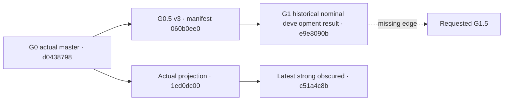

# Latest obscured dataset: lineage audit

**Verdict: the requested G0 → G0.5 → G1 → G1.5 chain is not satisfied.** The latest strong obscured dataset is a validated, actual-G0-derived development dataset. It is not a masked derivative of the existing G1 result.

Audit time: 2026-09-17T08:58:15.604981+07:00. Checkout: `feat/raw-overall-master`, `936cfbf7d3499715ac800c87a811152583d4e5c3`.

## What the files actually connect to

Both branches have the **same G0 parent**, verified by fresh SHA256. The mismatch is the processing branch, not an unidentified G0 version.

The masking builder explicitly selects `outputs.actual` from `downstream/reports/latest-build.json` (build.py lines 114–116), regenerates fictional company links (line 192), and asserts `g1_results_attached == 0` (line 218). It never consumes the existing G1 output or re-estimates G1. Its receipt states `g1_reestimated: false`.

## Fresh local verification

| Existing artifact | Rows | Company IDs | Nonmissing OP | Nonmissing LP / ACF / WRDG each |
|---|---:|---:|---:|---:|
| Actual G0 projection | 33,049 | 0 | 0 | 0 |
| Existing G1 development projection | 33,049 | 10,395 fictional | 683 | 10,315 |
| Latest strong obscured | 33,049 | 10,472 newly generated fictional | 0 | 0 |

Native Stata 17 read all three existing files and passed row-count, unique-key, readiness, G1-attachment and TFP-count assertions. `native-results.txt` contains the aggregate results; `check_existing.do` is the check and `run_audit.do` supplies local paths. This is a fresh read/validation run, **not** a fresh end-to-end G0/G0.5/G1 estimation run.

Fresh streamed hashes matched:

- Full G0 and G1 source DTAs, both projections, and the latest masked DTA.
- The exact G0.5 v3 manifest recorded as G1's input; all 28 data parts and 24 metadata files.
- All 8 files in the G1 handoff and all 90 outputs in its run manifest.
- All 12 projection code files and all 5 completed strong-masking code files.

The hydrated G0.5 package is in `/Users/natanaelmassie/Downloads/deasy-g1-issue9-20260913/data/g0-5-development/`. This repository checkout has its manifest/metadata but zero of the 28 Parquet parts locally; that is an infrastructure completeness item for the later phase.

## Version and interpretation limits

G1's recorded run is `v3-assumed-stock-all-years-02`, based on `g05-external-excel-panel-v3`, with recorded Stata exit code 0. Its nominal estimates use assumed capital and fictional longitudinal links. Its status is `DEVELOPMENT_NOMINAL_ESTIMATES_EXECUTED_REAL_PRIMARY_NOT_ADMITTED`; these are not verified actual-firm TFP results.

Only **40 of 52** current G1 code files match hashes recorded by that run. The other 12 exist but have different bytes; the historical working checkout shows the same mismatch count. This audit does not infer numerical effects from those differences. Reproducing with the current code requires a new recorded run or recovering the exact executed versions first. The individual paths/hashes are in `evidence.json`.

The earlier strong-masking receipt records successful native numeric replay, dummy-panel replay, categorical preservation, encrypted byte-exact recovery, and rejection of a wrong seed/tampered archive. This audit freshly verified the delivered file hash and retained seed/backup identifiers and permissions; it did not repeat all of those earlier masking tests. Both private seed copies remain present, match the accepted build and have mode 0600. Seed contents are absent from this report.

## Required before calling a result G1.5

1. Freeze one G0 → G0.5 → G1 lineage, including exact code, input hashes and intermediates, and run it locally.
2. Make the masking stage explicitly consume that selected G1 parent and record its hash. Preserve its company trajectories if only relabelling IDs; regenerating company links creates a different estimation panel.
3. Define treatment of G1 estimates when masking changes their numeric inputs. Keeping the old estimates would leave them inconsistent with the visible inputs; recompute them for the masked analysis or explicitly exclude them and label that scope. Do not silently attach historical TFP values to this newly generated panel.
4. Verify the final masked artifact, category/integer rules, all dependent formulas and retained owner recovery against that same lineage.

The user requested a report before infrastructure work. No GitHub edit, push, deletion of demos, data replacement, or pipeline restructuring was performed. Existing outputs and the seed remain intact.

Full evidence: `evidence.json`. This report is a **failed G1.5 lineage gate**, not a failed integrity check of the current masked G0 dataset.
