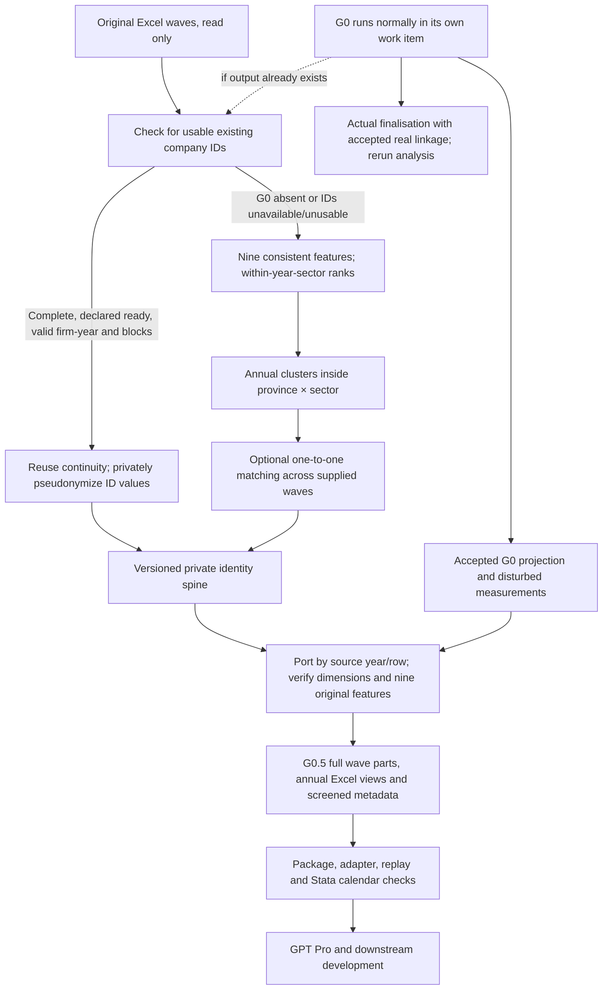

# G0.5 workflow outside G0

**Prepare company identity directly from Excel before G0 runs. Keep G0 unchanged.**
When its normal output becomes available, port the prepared identity into G0.5 by
verified observation lineage. G0.5 is the downstream development input; G0 remains
the actual-data preparation work item.

The current release follows the generation branch: the exact accepted G0 master
has 33,049 observations, zero populated selected/dummy company IDs and identity
mode `off`. G0.5 v3 supplies 10,395 fictional firms using province × sector and nine
continuous variables. Read the [inspection receipt](../../data/g0-5-development/g0-existing-identity-inspection.json)
and [current package](../../data/g0-5-development/README.md).



The arrows from G0 describe read-only input availability. No command below starts,
edits or replaces G0. A prepared identity spine can wait for its output.

## Inputs, outputs and ownership

| Object | Location / key | Treatment |
|---|---|---|
| Source Excel inventory | Private JSON; one entry per year, exact file SHA256 and sheet | Original workbooks are read only. |
| Optional accepted G0 master | Explicit private DTA path | Inspect IDs and provenance; never execute G0. |
| Existing company ID candidates | `psid`, `selected_firm_id`, `dummy_firm_id` | Prefer complete declared usable continuity that satisfies compulsory blocks. |
| Private identity spine | New private directory; workbook hash, sheet and source row | Prepare once, checksum and reuse; contains original feature values and must stay local. |
| Accepted actual projection | Private hash-bound G0 projection | Used to prove the Excel-to-G0 record binding. |
| Preserved disturbed measurements | Private G0.5 v1 package | Preserve existing measurements and `obs_id` exactly. |
| Screened identity payload | New local staging directory; keyed by existing `obs_id` | IDs, clusters, predecessors and normalized ranks; no source-row map or original levels. |
| Active G0.5 package | `data/g0-5-development/` | 33,049 × 4,396; 28 Parquet parts, 12 small annual Excel views. |
| Receipts and DAG | `data/g0-5-development/`, `work-items/G0.5/dag/` | Aggregate verification, decisions, dependencies and grain contracts. |

G0 and G0.5 are separate work items in `WS-deasy-imed-si-2010-2022`. G0.5 is the
owner's additional operational work item, not a new row in Deasy's 44 original
requests. The owner chooses the development identity rule; the harness executes
and records it; GPT Pro and other downstream actors consume the published version
through the shared adapter. Every output must identify its data mode and version.

## 1. Configure the private inputs

Copy [external-workflow.example.json](external-workflow.example.json) outside the
Git checkout and replace the `/LOCAL/` paths. Keep the existing private 32-byte
G0.5 key; do not create a new key on every run. The example's `g0_master` may point
to an output that does not exist yet, or be `null` during preparation.

The Excel inventory is a list with this shape (one entry per supplied wave):

```json
[
  {
    "year": 2014,
    "path": "/LOCAL/original-wave-2014.xlsx",
    "sha256": "EXACT_SHA256_OF_THE_WORKBOOK",
    "sheet": "Sheet1",
    "max_row": 2501
  }
]
```

`max_row` includes the header. Use the actual sheet name and row count. Outputs
must use new directories. Original inputs, private keys and the row-level identity
spine stay outside Git. [Source coverage evidence](../../data/g0-5-development/source-selected-fields.json)
records the selected headers for the current 12 waves without publishing records.

## 2. Prepare identity first

```sh
python3 -m pip install -r harness/g05/requirements.txt
OPENBLAS_NUM_THREADS=1 OMP_NUM_THREADS=1 python3 harness/g05/external_workflow.py prepare \
  --config /LOCAL/g05-workflow.json --receipt /LOCAL/prepare-receipt-001.json
```

The process reads Excel, optionally checks an already available G0, and writes a
private identity spine. An existing ID must be nonmissing for every supplied
observation, declared panel-ready, unique by firm × year, have cross-year reuse,
and respect province × sector. A column merely named `psid` is insufficient.
An accepted existing association is retained; its original numeric value is
privately replaced by a surrogate. A partial or observation-only ID is recorded
as unusable and the generator branch runs.

The generation branch uses annual clusters and optional one-to-one matching with
unmatched choices; [the method](PANEL-GENERATOR.md) specifies all nine fields,
weights, thresholds and calendar rules. Annual cluster IDs differ from firm IDs.

## 3. Port after the ordinary G0 output is available

```sh
OPENBLAS_NUM_THREADS=1 OMP_NUM_THREADS=1 python3 harness/g05/external_workflow.py port \
  --config /LOCAL/g05-workflow.json --receipt /LOCAL/port-receipt-001.json
```

This step uses the accepted G0 master, its hash-bound actual projection and the
preserved disturbed package. These are existing inputs; the command does not
produce them by invoking G0. Source year and source-row keys must cover exactly
the same observation universe. Province, sector and all nine original feature
values must agree. A mismatch fails; the code never guesses a new positional
company link. External observation tokens and predecessors are translated to the
existing G0.5 `obs_id` values.

If G0 is still absent, the receipt states `IDENTITY_READY_AWAITING_G0_OUTPUT`.
That means identity preparation is finished, not that the downstream data package
has been published.

## 4. Package and verify

```sh
OPENBLAS_NUM_THREADS=1 OMP_NUM_THREADS=1 python3 harness/g05/external_workflow.py all \
  --config /LOCAL/g05-workflow.json --receipt /LOCAL/package-receipt-001.json
python3 -m unittest discover -s harness/g05 -p 'test_*.py' -v
python3 harness/g05/replay_panel.py --package /LOCAL/staging/g05-external-panel-v3 \
  --output /LOCAL/replay-receipt-001.json
```

`all` reuses verified preparation/port outputs and builds the new package if
needed. Changed inputs require a new version and reconciliation, rather than
silently replacing existing assignments. The builder checks exact measurement
preservation, input reordering and Parquet/Excel roundtrips. Independent package
and adapter checks follow, plus [native Stata checks](verify_panel.do) of firm-year
uniqueness, `xtset` and actual calendar lags. Stata remains the downstream
estimation layer; this workflow performs data preparation and validation only.

For the current generated panel, GitHub-only replay reproduces every assignment
from the published keyed tokens and frozen ranks, without the original Excel or
private key. When an existing ID is reused, its continuity is an explicit input:
check the published associations and port provenance instead of claiming that
the similarity algorithm generated them.

After validation, the screened package and documentation are committed to the
private repository, remote `main` is checked, and the 14 implementation issues
are bound to that dataset version. All 43 downstream source-row plans use G0.5
by default. Registration does not execute their analyses or resume paused G1.

## 5. Consume and finalise

```python
from harness.data_source import load_data

development = load_data(require_panel=True, columns=[
    "obs_id", "source_year", "psid", "psid_status", "workers"
])
```

Development `psid_status` is `synthetic_development`. Finalisation selects an
explicit accepted local actual input and reruns the same analysis body and all
outputs. The actual adapter preserves observation IDs but clears fictional
company IDs, clusters, predecessors, keyed identity tokens and frozen ranks.
Actual panel estimation still needs independently accepted real linkage; the
current G0 source does not provide it. Read the [mode contract](../../docs/DATA-MODES.md)
before switching inputs. Small measurement perturbations and simulated continuity
are for development; they do not establish actual company histories.
