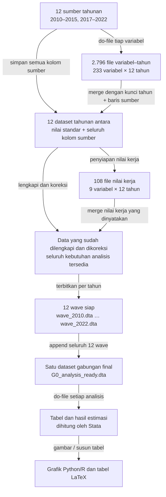

# Satu sumber data untuk seluruh analisis

**Status: 12 wave dan master gabungan sudah terbentuk dan lulus pemeriksaan nilai serta skema.** Master memuat 33.049 baris dan 4.593 kolom. Penghitungan ulang seluruh tabel masih berjalan dan dicatat terpisah. Rilis dan PDF sebelumnya tetap tersimpan sebagai hasil versi terdahulu.

File hasil tiap variabel harus menjadi bahan penggabungan yang sesungguhnya. Setelah penyiapan selesai, setiap tahun mempunyai satu wave lengkap. Kedua belas wave digabung menjadi satu `G0_analysis_ready.dta`. Seluruh analisis mengambil data perusahaan dari file gabungan ini atau hasil turunannya, termasuk analisis satu tahun.

Ini diagram ringkas rencana perbaikan; bukti setiap file dan proses dicatat dalam registri pelaksanaan. “Tahunan antara” masih boleh memerlukan pengolahan. “Wave siap” sudah melewati pengolahan itu. Penggabungan beberapa tahun untuk keperluan penyiapan dilakukan sebelum penerbitan wave siap.

## Yang diperbaiki

| Bagian | Perubahan yang diwajibkan |
|---|---|
| Penyusunan wave | Gabungkan file hasil per variabel yang tersimpan; tidak cukup menyimpan dataset yang kebetulan terbuka. |
| Kolom tambahan dan koreksi | Selesaikan di hulu, lalu masukkan ke wave. Dataset final lama hanya menjadi pembanding. |
| R&D 2017 | Buka dataset gabungan, lalu pilih tahun 2017. Dua kategori jawaban disiapkan lebih dulu supaya kosong dan tidak sah tetap dibedakan. |
| Tabel kelengkapan dan status | Hitung ulang dari dataset gabungan baru, tanpa menyalin ringkasan angka lama. |
| Semua modul berikutnya | Kalau ada variabel yang belum tersedia, perbaiki penyiapan dataset gabungan dahulu. Jangan membuka sumber perusahaan lain di tengah analisis. |

Referensi harga, kamus, dan keterangan berkas dicatat tersendiri. Referensi tidak menggantikan data perusahaan dan tidak otomatis mengesahkan definisi yang masih perlu diperiksa.

## Bukti yang harus selesai

- Dataset gabungan final memuat seluruh 33.049 baris dan skema 4.593 kolom yang sama. Semua nilai pada 4.591 kolom lama harus tetap persis. Dua belas wave tetap disimpan untuk diperiksa.
- Penggabungan benar-benar memakai 2.796 file variabel dan 108 file nilai kerja; kunci yang tidak cocok atau kolom yang bertabrakan menghentikan proses.
- Semua 30 tabel utama dan hasil R&D 2017 dibandingkan dengan hasil sebelumnya. Perubahan metadata atau dua kolom baru dijelaskan terpisah.
- Pemeriksaan kode memastikan tidak ada hitungan perusahaan yang mengambil input di luar dataset gabungan atau turunannya.

Perbaikan alur ini tidak menyelesaikan persoalan sumber yang masih terbuka: identitas perusahaan lintas tahun, padanan klasifikasi/harga, serta pengesahan sebagian satuan energi. Seluruh 44 baris assignment menerima aturan input baru, tetapi tidak dinyatakan telah selesai dianalisis.
