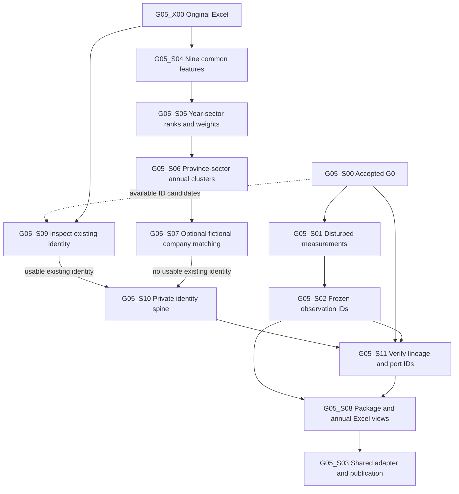

# G0.5 analytical DAG

The [full external workflow](../../../harness/g05/EXTERNAL-WORKFLOW.md) can prepare
identity from Excel before G0 exists. The accepted G0 and measurement stages remain
unchanged. The private identity spine is attached later by proved source lineage.

Each row is retained. New metadata describes fictional development continuity;
actual finalisation clears it. Missing 2016 stays missing. Existing identity is an
explicit input when reused; it is not represented as newly generated matching.
Node triage/decision files and registries record keys, grain, evidence and reopen
conditions. Publication acceptance is recorded separately from local validation.
